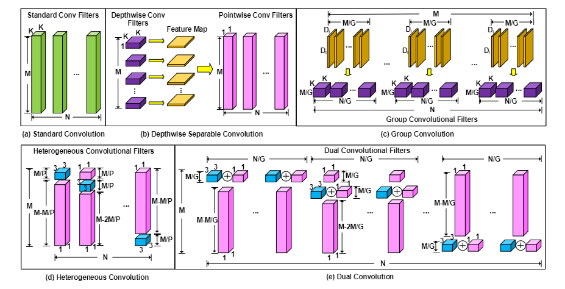
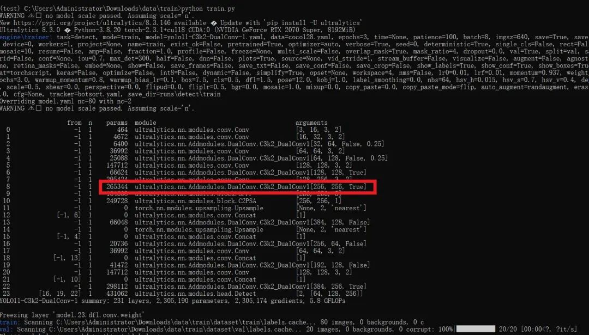

# [yolov11 Improvement Series] Python Source Code + Training Source Code for Lightweight Networks Based on yolov11 with DualConv

[DualConv Introduction]CNN architectures typically require high memory and computational resources, which makes them challenging to implement in embedded systems with limited hardware resources.

​

[DualConv Introduction]

CNN architectures typically require high memory and computational resources, making them challenging to implement in embedded systems with limited hardware resources. We propose a method for constructing lightweight deep neural networks using dual convolutional kernels (DualConv). DualConv combines $3 \times 3$ and $1 \times 1$ convolutional kernels to process the same input feature maps simultaneously, utilizing group convolution techniques to efficiently arrange convolutional filters. DualConv can be applied to any CNN model, such as VGG-16 and ResNet-50 for image classification, YOLO and R-CNN for object detection, or FCN for semantic segmentation. In this paper, we extensively test the performance of DualConv on classification tasks, as these network architectures form the backbone for many other tasks. We also test the image detection performance of DualConv on YOLO-V3. Experimental results show that, combined with our structural innovations, DualConv significantly reduces the computational cost and parameter count of deep neural networks, achieving surprisingly higher accuracy in some cases than the original models. We further reduce the number of parameters in Lightweight MobileNetV2 by 54% using DualConv, dropping only 0.68% accuracy on the CIFAR-100 dataset. When parameter count is not an issue, DualConv improves accuracy by 4.11% on MobileNetV1 over the same dataset. Additionally, DualConv significantly enhances the speed of object detection in YOLO-V3 and increases accuracy by 4.4% on the PASCAL VOC dataset.

Basic principle

DualConv is an innovative deep neural network technology aimed at building lightweight deep neural networks.

Double Convolutional Kernel Structure:

DualConv combines 3x3 and 1x1 convolution kernels to process the same input feature maps simultaneously. Through this combination, DualConv can reduce network computational cost and parameter count while maintaining accuracy.

3x3 convolutional kernels are commonly used to capture local features and spatial information, facilitating the extraction of fine-grained features from input feature maps.

In the dual-convolutional kernel structure, the 3x3 convolutional kernel is responsible for processing the channel dimensions of the input feature map, thereby achieving deep extraction and representation of features.

1x1 convolutional kernels are typically used to reduce the number of channels in feature maps, lowering computational costs and parameter counts while facilitating feature fusion and compression.

In the dual-kernel structure, the 1x1 kernel is combined with the 3x3 kernel to achieve accurate results while effectively reducing parameters and enhancing computational efficiency.

The dual convolutional kernel structure enables the 3x3 and 1x1 convolutional kernels to process the same input feature maps simultaneously, thereby accelerating computation speed and enhancing the efficiency and performance of the network.

Concurrently processing different types of convolutional kernels aids the network in capturing feature information at various scales and effectively integrates this information, enhancing the network's representational and generalization capabilities.

The dual-kernel structure achieves the goal of improving accuracy, reducing computational cost, and decreasing parameter count in lightweight deep neural networks by combining 3x3 and 1x1 convolution kernels.

This design structure enables the network to maintain high accuracy while achieving higher computational efficiency and fewer parameters, making it suitable for deployment and application in resource-constrained environments.

Overall, the technical principle of the dual-kernel structure lies in fully utilizing the advantages of 3x3 and 1x1 convolution kernels while processing input feature maps channels, achieving the goals of efficiency, accuracy, and generalization capabilities in deep neural networks.

[Introduction to YOLOv11 Framework]

On September 30, 2024, Ultralytics officially released YOLOv11 during its event YOLOVision. YOLOv11 is the latest version of YOLO, developed by the team from both the United States and Spain, Ultralytics. YOLO stands for You Only Look Once, a computer vision algorithm used in image-based artificial intelligence.

Ultralytics YOLO11 overview

YOLO11 is the latest version of the Ultralytics YOLO series of real-time object detectors, redefining possibilities with cutting-edge precision, speed, and efficiency. Building on impressive advancements from previous YOLO versions, YOLO11 introduces significant improvements in architecture and training methods, making it a versatile choice for various computer vision tasks.

Key Features

Enhanced feature extraction: YOLO11 employs an improved backbone and neck architecture, enhancing feature extraction capabilities to achieve more precise object detection and complex task performance.

Optimization for efficiency and speed: YOLO11 introduces refined architecture design and optimized training pipelines, providing faster processing speeds while maintaining the best balance between accuracy and performance.

Achieving higher accuracy with fewer parameters: With the advancement of model design, YOLOv11m has achieved higher average precision (mAP) on the COCO dataset while using 22% fewer parameters than YOLOv8m, thereby improving computational efficiency without compromising accuracy.

Cross-environment adaptability: YOLO11 can be seamlessly deployed in various environments, including edge devices, cloud platforms, and systems supporting NVIDIA GPUs, ensuring maximum flexibility.

Supports a wide range of tasks: whether it's object detection, instance segmentation, image classification, pose estimation, or Oriented Object Detection (OBB), YOLO11 aims to tackle various computer vision challenges.

Compared to previous versions, what are the key improvements in Ultralytics YOLO11?

Ultralytics YOLO11 introduces several significant improvements compared to its predecessor. The main improvements include:

Enhanced feature extraction: YOLO11 employs an improved backbone and neck architecture, enhancing feature extraction capabilities to achieve more precise object detection.

Optimized efficiency and speed: Precise architectural design and optimized training pipelines provide faster processing speeds while maintaining a balance between accuracy and performance.

Achieving higher accuracy with fewer parameters: YOLOv11m achieves higher average precision (mAP) on the COCO dataset, reducing its parameters by 22% compared to YOLOv8m, while improving computational efficiency without compromising accuracy.

Cross-environment adaptability: YOLO11 can be deployed across various environments, including edge devices, cloud platforms, and systems supporting NVIDIA GPUs.

Supports a wide range of tasks: YOLO11 supports various computer vision tasks, such as object detection, instance segmentation, image classification, pose estimation, and Oriented Object Detection (OBB).

[Test Environment]

windows10 x64

ultralytics==8.3.0

torch==2.3.1

[Improvement Process]

1. Add a new module called DualConv.py to implement the functionality (the code is too extensive, please refer to the improved steps.docx for the core module source code). Then create a __init__.py file in the same directory and write the code.

from .DualConv. import *

2. Steps for file modification

Modify tasks.py file

Create model configuration file

The content of yolo11-C3k2-DualConv-1.yaml is as follows:

# Ultralytics YOLO 🚀, AGPL-3.0 license

# YOLO11 object detection model with P3-P5 outputs. For Usage examples see https://docs.ultralytics.com/tasks/detect

# Parameters

nc: 80 # number of classes

scales: # model compound scaling constants, i.e. 'model=yolo11n.yaml' will call yolo11.yaml with scale 'n'

  # [depth, width, max_channels]

  n: [0.50, 0.25, 1024] # summary: 319 layers, 2624080 parameters, 2624064 gradients, 6.6 GFLOPs

  s: [0.50, 0.50, 1024] # summary: 319 layers, 9458752 parameters, 9458736 gradients, 21.7 GFLOPs

  m: [0.50, 1.00, 512] # summary: 409 layers, 20114688 parameters, 20114672 gradients, 68.5 GFLOPs

  l: [1.00, 1.00, 512] # summary: 631 layers, 25372160 parameters, 25372144 gradients, 87.6 GFLOPs

  x: [1.00, 1.50, 512] # summary: 631 layers, 56966176 parameters, 56966160 gradients, 196.0 GFLOPs

# YOLO11n backbone

backbone:

  # [from, repeats, module, args]

  - [-1, 1, Conv, [64, 3, 2]] # 0-P1/2

  - [-1, 1, Conv, [128, 3, 2]] # 1-P2/4

  - [-1, 2, C3k2_DualConv1, [256, False, 0.25]]

  - [-1, 1, Conv, [256, 3, 2]] # 3-P3/8

  - [-1, 2, C3k2_DualConv1, [512, False, 0.25]]

  - [-1, 1, Conv, [512, 3, 2]] # 5-P4/16

  - [-1, 2, C3k2_DualConv1, [512, True]]

  - [-1, 1, Conv, [1024, 3, 2]] # 7-P5/32

  - [-1, 2, C3k2_DualConv1, [1024, True]]

  - [-1, 1, SPPF, [1024, 5]] # 9

  - [-1, 2, C2PSA, [1024]] # 10

# YOLO11n head

head:

  - [-1, 1, nn.Upsample, [None, 2, "nearest"]]

  - [[-1, 6], 1, Concat, [1]] # cat backbone P4

  - [-1, 2, C3k2_DualConv1, [512, False]] # 13

  - [-1, 1, nn.Upsample, [None, 2, "nearest"]]

  - [[-1, 4], 1, Concat, [1]] # cat backbone P3

  - [-1, 2, C3k2_DualConv1, [256, False]] # 16 (P3/8-small)

  - [-1, 1, Conv, [256, 3, 2]]

  - [[-1, 13], 1, Concat, [1]] # cat head P4

  - [-1, 2, C3k2_DualConv1, [512, False]] # 19 (P4/16-medium)

  - [-1, 1, Conv, [512, 3, 2]]

  - [[-1, 10], 1, Concat, [1]] # cat head P5

  - [-1, 2, C3k2_DualConv1, [1024, True]] # 22 (P5/32-large)

  - [[16, 19, 22], 1, Detect, [nc]] # Detect(P3, P4, P5)

3. Verification of integration

Start training tasks using the newly created yaml configuration file:

from ultralytics import YOLO

if __name__ == '__main__':

    model = YOLO('yolo11-C3k2-DualConv-1.yaml')  # build from YAML and transfer weights

        # Train the model

    results = model.train(data='coco128.yaml',epochs=100, imgsz=640, batch=8, device=0, workers=1, save=True,resume=False)

After successful integration, the training log will show initialization information for the DualConv. module, indicating that it has been correctly loaded into the model.

[Training Instructions]

Step 1: First, ensure that the necessary modules for YOLOv11 are installed. You can refer to the installation process of the YOLOv11 framework. Then, uninstall the official version of pip by running `pip uninstall ultralytics`. Finally, install the improved source code by running `pip install .`

Step 2: Arrange your dataset in the dataset folder, ensuring that the folder names remain unchanged.

Step 3: Open the train.py, coco128.yaml and model parameters yaml files separately to modify the necessary parameters, and then execute python train.py to train.

[Provided Files]

├── [Official Source Code]ultralytics-8.3.0.zip

├── train/

│   ├── coco128.yaml

│   ├── dataset/

│   │   ├── train/

│   │   │   ├── images/

│   │   │   │   ├── firc_pic_1.jpg

│   │   │   │   ├── firc_pic_10.jpg

│   │   │   │   ├── firc_pic_11.jpg

│   │   │   │   ├── firc_pic_12.jpg

│   │   │   │   ├── firc_pic_13.jpg

│   │   │   ├── labels/

│   │   │   │   ├── classes.txt

│   │   │   │   ├── firc_pic_1.txt

│   │   │   │   ├── firc_pic_10.txt

│   │   │   │   ├── firc_pic_11.txt

│   │   │   │   ├── firc_pic_12.txt

│   │   │   │   ├── firc_pic_13.txt

│   │   └── val/

│   │       ├── images/

│   │       │   ├── firc_pic_100.jpg

│   │       │   ├── firc_pic_81.jpg

│   │       │   ├── firc_pic_82.jpg

│   │       │   ├── firc_pic_83.jpg

│   │       │   ├── firc_pic_84.jpg

│   │       ├── labels/

│   │       │   ├── firc_pic_100.txt

│   │       │   ├── firc_pic_81.txt

│   │       │   ├── firc_pic_82.txt

│   │       │   ├── firc_pic_83.txt

│   │       │   ├── firc_pic_84.txt

│   ├── train.py

│   ├── yolo11-C3k2-DualConv-1.yaml

│   ├── yolo11-C3k2-DualConv-2.yaml

└── training_notes.txt

├── [Improved Source Code]ultralytics-8.3.0.zip

├── Improvement Principles.docx

└── Improved Process.docx

[Common Issues Summary]

Question: Why does the map of my model's epoch display as 0 or have very low accuracy?

Answer: Due to the source code being improved, it is not possible to directly fine-tune from the official model. Instead, training from scratch is required, which will result in weaker learning of features and requires many epochs for effects to emerge. Moreover, since the improved source code framework may not necessarily guarantee surpassing the official accuracy, there is also a possibility of achieving far worse results or even very low precision. This indicates that the improved framework does not yield good results. Therefore, for framework improvements, it merely provides a viable solution. Whether the improvements can lead to excellent performance still needs to be confirmed based on actual training conditions. Of course, this does not rule out the possibility of dataset issues, such as a single dataset, unbalanced sample distribution, limited generalization scenarios, poor annotation quality, and small detection targets among other reasons.

[Important Notice]

We only offer one improvement framework solution, and we do not guarantee that it will achieve excellent training accuracy or even surpass the accuracy of official models. The improvement framework is actually a complex process including the feasibility of the framework principle, whether the training dataset is appropriate, the need for back-propagation validation, as well as the comparison of parameter results from similar frameworks. This is a very complex and lengthy process.

​

## Payment

Here is a pay link on Stripe ( https://buy.stripe.com/3cs8yP7sY87d0vu9AB ). Please contact me lonlonago@foxmail.com after funding $89, and I will send you a complete data files , thank you!

